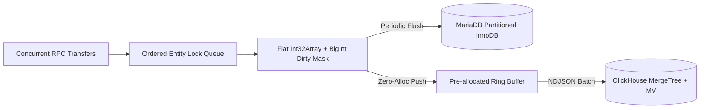

# Highload Anti-Dupe Inventory Engine (Node.js + MariaDB + ClickHouse)

Высокопроизводительное серверное ядро инвентаря и экономики для игровых проектов (RAGE:MP / alt:V), спроектированное для работы под высокой нагрузкой с защитой от race condition (дюпа предметов), минимальным давлением на V8 GC и асинхронным сбросом данных в MariaDB и ClickHouse.

## Архитектура и поток данных



## Инженерные решения под требования Highload

1. **Защита от дюпа и Deadlock (`src/core/entity-lock.ts`):**
   Каждая операция блокирует цепочку промисов по отсортированному списку ключей контейнеров (`OwnerType:OwnerId`). Детерминированный порядок захвата полностью исключает взаимную блокировку (deadlock) при встречных обменах (`Player A ↔ Player B`) и выстраивает конкурентные запросы в строгую очередь.
2. **Снижение аллокаций и GC-давления (`src/core/inventory-engine.ts`):**
   Слоты контейнера хранятся в плоском непрерывном буфере `Int32Array` (stride = 3: `itemDefId`, `amount`, `durability`) вместо массива JS-объектов. Измененные слоты отслеживаются 64-битной маской `dirtyMask: bigint` без выделения памяти на куче.
3. **Оптимизация MariaDB (`sql/mariadb_schema.sql`, `src/storage/mariadb-batcher.ts`):**
   * Таблица `inventory_slots` секционирована (`PARTITION BY HASH(owner_id) PARTITIONS 32`) с составным кластерным индексом `(owner_id, owner_type, slot_idx)` для локализации I/O.
   * Write-Behind батчер вычитывает только выставленные биты `dirtyMask` и формирует единый `INSERT ... ON DUPLICATE KEY UPDATE` вместо десятков точечных запросов на каждый клик игрока.
4. **Аналитика экономики в реальном времени (`sql/clickhouse_schema.sql`, `src/telemetry/clickhouse-ring-buffer.ts`):**
   * Pre-allocated кольцевой буфер переиспользует объекты событий при записи, предотвращая спайки сборщика мусора при пиковом онлайне.
   * Схема ClickHouse использует `MergeTree` с сортировкой `(item_def_id, src_owner_id, ts, tx_id)` и `SummingMergeTree` Materialized View для мгновенной агрегации оборота предметов и поиска аномалий без `JOIN`.

## Результаты нагрузочного тестирования и аудита безопасности

Замер выполнен на Node.js с принудительной сборкой мусора (`--expose-gc`):

| Тестовый сценарий | Метрика | Результат |
| :--- | :--- | :--- |
| **Anti-Dupe Race Audit (1000 параллельных переводов 1 предмета)** | Успешных переводов / Отклонено | `1 / 999` (`dupeDetected: false`) |
| **Throughput Benchmark (25 000 атомарных транзакций)** | Пропускная способность | `320 515 ops/sec` (`78 ms`) |
| **Memory Footprint** | Дельта кучи (Heap Delta) | `+977.02 KB` |
| **MariaDB Write-Behind** | Сэкономлено SQL-запросов | `62` (63 слота → `1` batch) |
| **ClickHouse Telemetry** | Сброшено событий одним батчем | `25 000 events` |

## Запуск проверки типов и бенчмарков

```bash
npm install
npm run typecheck
npm run bench
```
